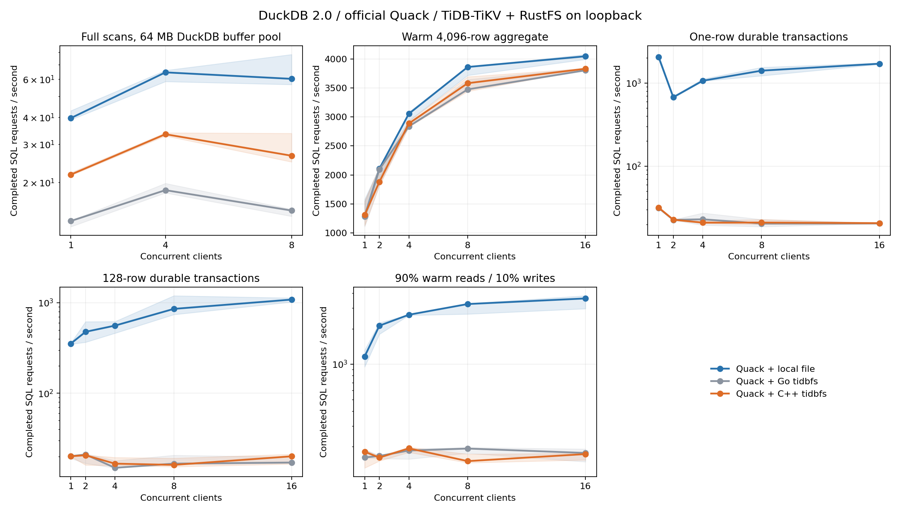
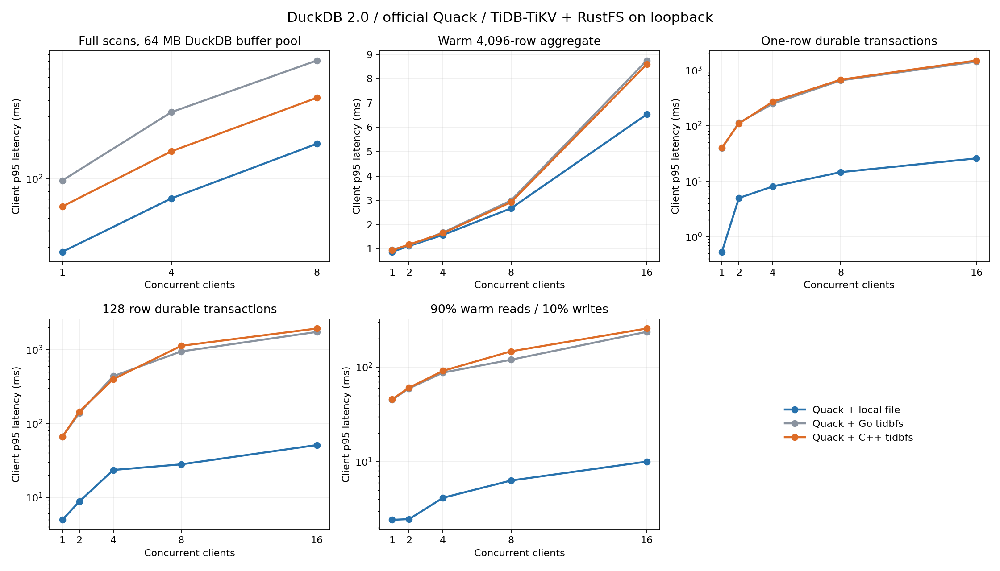

# Pure C++ client: validation and performance

The extension now uses the public [drive9 C++ HTTP SDK](https://github.com/mem9-ai/drive9/pull/1056).
`cpp-sdk-revision.txt` pins its exact source. There is no Go bridge, embedded Go
runtime or companion runtime library. Existing server endpoints, sessions,
locks, open references, object keys and slice layouts are reused unchanged.

The analytical path continues to use `/v1/fs` conditions, Range and revision CAS.
Native and existing extent files use `/v1/extent/meta` and
`/v1/data-credential`, then direct immutable object I/O. Acknowledged writes
still wait for object upload and metadata publication. The SDK coalesces block
downloads, shares immutable cache buffers and copies requested bytes into
DuckDB's destination without a language boundary.

The only required API extension is generic, opt-in atomic directory creation in
[fs #274](https://github.com/tidbcloud/fs/pull/274): `mknod.create_projection`,
advertised by `new_session.directory_projection`. Its default preserves the
existing Go/FUSE mkdir sequence. No endpoint, table or lock protocol is added.

## Validation

The independent SDK tests cover binary and sparse reads, slice overlays,
large session IDs, lost acknowledgements, late publication after session
cleanup, credential binding, concurrent readers and close/read ordering.
Network tests cover bounded requests, pool recovery and redirect rejection.
They preserve 404/503 statuses even when an error document exceeds a short
object's size limit. Headers and body share the request's monotonic deadline;
the low-level cpp-httplib request clock is initialized explicitly. Teardown
keeps heartbeats active while I/O drains, serializes concurrent shutdown, and
releases inode entries after final close or failed open. Gated regressions
reproduce the former shutdown and inode-retention defects before their fixes.
Sync waits for in-flight publication while immutable downloads continue; a
gated regression fails with the former exclusive Sync lock and passes with
the shared barrier. Legacy servers reject unsafe directory mutations. Raw
metadata regressions cover classic-only rename targets without relying on a
client preflight, including target type, nonempty targets and valid replacement.
Directory subtree matching remains byte-exact under case-insensitive collations,
including case/accent neighbors and names containing SQL wildcard characters.
Cloud credential regressions cover omitted S3/GCS endpoints, authoritative
signing regions, generated AWS partition DNS data, custom/FIPS/VPC endpoints,
TLS-safe dotted-bucket addressing and scoped GCS OAuth. These protocol fixtures
do not claim production AWS/GCS fault certification; live object tests use RustFS.
Linux SDK CI enables address and undefined-behavior sanitizers; macOS runs the
same suite. The integration harness runs direct C++ protocol conformance before
the native database and Quack suites, using isolated TiDB/TiKV and RustFS.

`TIDBFS_INTEROP_EXTENSION=/path/to/prior/tidbfs.duckdb_extension` enables the
prior-client compatibility test. It creates a database with the prior client,
reads and changes it with C++, then reopens it with the prior client. It also
reads C++-created extent Parquet through the prior client's ordinary URI route.
The prior client then writes again while C++ files remain live, checking both
slice-ID and inode-ID reservation boundaries. This regression reproduces an
I/O failure with the initial C++ draft; the SDK now uses the same half-open,
batched ID reservations as the existing clients and supplies explicit inodes.
This requires only a historical test artifact; Go is absent from the current
plugin build and runtime.

## Linux timeout investigation

The earlier Linux failure was reproduced after the Sync fix. During a stalled
scan, the object proxy had already written each response in at most 34 ms, but
the worker repeatedly received only 2 KiB every approximately 208 ms. A 256 KiB
block could take around 26.6 seconds. Plugin-free Quack/local-file controls
passed with both default and single-thread HTTP scheduling. Hidden HTTP symbols
also ruled out interposition between Quack and the SDK's cpp-httplib copy.

Packet-header and socket-memory captures narrowed this to receive-window
starvation: affected worker sockets had a 1,371-byte receive buffer and the
sender advertised only a 2 KiB window, with retransmissions. Quick-ACK hints
alone did not fix it. A controlled established-socket regression reproduced
that enlarging the receive buffer alone still leaves Linux's window clamp at
1,566 bytes. The repair restores both only when a connection's receive buffer
has fallen below 64 KiB, preserving autotuning on normal connections. The same
regression requires a complete, byte-exact download after repair; the
unprotected connection must still respect the overall request deadline.
The latest Linux integration status is tracked on the migration PR. These captures identify
the stalled transport state, not a proven kernel-version-specific root cause.
The deadline fix also removes a sanitizer-detected clock overflow in low-level
HTTP requests.

Normal Linux CI rebuilds the plugin, repeats multipart success/abort 30 times in
each HTTP scheduling mode, and runs the remote concurrent scan/write case three
times. Timeout diagnostics retain worker/client stacks and payload-free socket
traces. The final CI results and artifact identity are reported with the final
measurements below.

## Comparison method

The new comparison uses `scripts/benchmark_quack.py` with three independent
Quack workers: pure C++ tidbfs, the previous optimized Go-backed tidbfs and local
files. The Go baseline already uses direct-buffer reads and the same 64 MiB
client cache budget; results compare complete implementations rather than
isolating language-boundary overhead. DuckDB, Quack, server, RustFS, data, thread counts and durability policy
are held constant. Runs are sequential, backend order rotates, and each
configuration has three trials. Measurements include throughput, p50/p95/p99,
worker/server CPU and RSS, object/metadata operations, integrity and host paging.

Streaming scans exceed the worker's buffer pool. The mixed workload contains
90% reads and 10% writes. Hot reads, single-row commits and 128-row commits
exercise different bottlenecks. A whole comparison triplet is excluded if any
backend exceeds the predefined host paging limits. The complete raw data and
eligibility decisions are retained. These are same-host loopback measurements;
they do not predict WAN or production object-store latency.

## Measured results

Apple M4, 10 logical CPUs, 24 GiB RAM; DuckDB 2.0, official Quack,
TiDB/TiKV 8.5.3 and RustFS 1.0.3. The matrix uses 1/2/4/8/16 clients,
four configured worker threads and a 1 GB buffer pool; streaming scans use
1/4/8 clients and a 64 MB buffer pool with 128 MiB of uncompressed input.
The matrix admits requests for eight seconds per trial and streaming scans
for ten seconds, then drains in-flight work. There are 207 selected runs;
two complete triplets were excluded by the predefined paging thresholds and
repeated. No result was selected based on throughput.

At eight concurrent clients, median SQL requests per second:

| Workload | Local file | Go tidbfs | C++ tidbfs | C++ vs Go |
|---|---:|---:|---:|---:|
| Buffer-limited full scans | 60.25 | 14.82 | 26.57 | +79.3% |
| Warm 4,096-row aggregate | 3863.38 | 3476.62 | 3583.40 | +3.1% |
| One-row durable transaction | 1404.77 | 20.46 | 21.04 | +2.8% |
| 128-row durable transaction | 854.27 | 16.71 | 16.18 | −3.2% |
| 90% warm reads / 10% writes | 3239.98 | 192.70 | 150.76 | −21.8% |

Full-scan p95 falls from 807.07 to 417.84 ms; local file is 185.70 ms.
One-row commit p95 is 652.19 ms for Go and 672.34 ms for C++.
Mixed-workload p95 increases from 119.39 to 146.63 ms. Small throughput
differences are within trial variability; the migration is not a general
write-latency improvement. Full-scan throughput still reaches only 44.1% of
local storage. Four clients outperform eight for both remote implementations,
so more reader concurrency alone does not remove the remaining bottleneck.

The remote write cases use very little worker CPU (about 0.05–0.08 cores),
and throughput stops scaling as clients increase. Synchronous object uploads
and metadata publication remain on the durable commit path, with queueing
visible in tail latency. This supports investigating I/O and commit
serialization before more CPU parallelism. It does not separate the cost of
object upload, metadata transactions, transport delays and Quack scheduling.
The mixed-workload regression also needs such attribution: do not describe
it as a read-path win or weaken durability to hide it.

Further optimization candidates are bounded parallel block fetch/prefetch
for scans, profiling the remaining cache/mapping/copy costs, and reducing
measured commit-path round trips where existing generic APIs permit it.
Any batching needs explicit acknowledgement and recovery semantics. The
current evidence does not justify a new DuckDB-specific server protocol.

The C++ extension is 1.42 MiB versus the prior Go artifact's 57.70 MiB,
excluding shared system libraries. Both prior Go and C++ implementations
already copy reads directly into the destination and use the same 64 MiB
cache budget; this comparison does not isolate CGo overhead. OS and object
caches were not purged. It is not a cold-storage, WAN, Linux performance or
production object-store failure certification.

[All configurations and latencies](benchmarks/2026-10-26-cpp-client/summary.csv),
[raw samples, metrics and reproduction scripts](benchmarks/2026-10-26-cpp-client/quack-cpp-client-results.zip),
and [exact artifact provenance](benchmarks/2026-10-26-cpp-client/results.json)
are retained. The earlier [Go bridge report](read-performance.md) remains
historical evidence.

The original full validation and timed runs used SDK `be5784c0`; rebuilding
with final SDK `9a1fac5f` after its Linux-only transport repair produced the
**same SHA-256** (`9808d858f8874266315f7b39f0e1b1362ffb80e937cc7ec4a30cf388673cec6c`)
on macOS. The original measurement identity and final rebuild identity are
both recorded, rather than relabeling old measurements. The new SDK's
standalone macOS and Linux sanitizer tests pass; its constrained Linux HTTP
regression completes 256 KiB in 414 ms versus a 2-second timeout after
47,104 bytes without repair. Full validation used 31 analytical tests, live C++
conformance, Go → C++ → Go compatibility, 22 native cases, eight Quack cases
and process/server-kill recovery.

Linux integration also passed on plugin commit `4fd36cd` in both
[PR CI](https://github.com/siddontang/duckdb-tidbfs/actions/runs/40305803871)
and [push CI](https://github.com/siddontang/duckdb-tidbfs/actions/runs/40305795765):
30 multipart success/abort repetitions in each HTTP scheduling mode, native
compatibility and Quack failure/handoff cases, plus three buffer-limited
concurrent scan/WAL-write repetitions per run. Both plugin-free local-file
controls passed as well.
