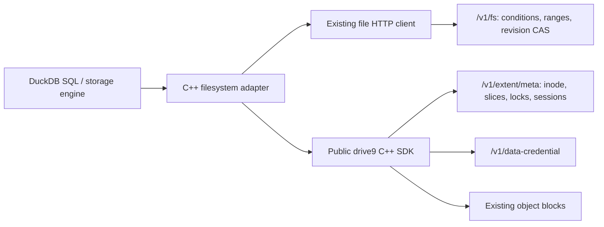

# Native DuckDB over existing extent storage

The extension implements DuckDB's C++ FileSystem interface and links the public
[drive9 C++ SDK](https://github.com/mem9-ai/drive9/pull/1056), pinned by
`cpp-sdk-revision.txt`. The SDK calls the existing HTTP APIs directly. It has no
Go bridge, embedded Go runtime, FUSE daemon or separately deployed client service.
Its object keys, slice maps, sessions and locks remain compatible with existing
extent clients.

## Files and requests

`tidbfs+db:///warehouse.duckdb` maps to `/warehouse.duckdb`, with the usual
`.wal` and `.tmp/` sidecars. Arbitrary base filenames are accepted. All of these
are normal extent files, visible through `/v1/fs` metadata and listing. The
server has no DuckDB filename, WAL, transaction or checkpoint logic.



`tidbfs:///` keeps the conditional-read and CAS-upload implementation for ordinary
analytical files. Existing extent-layout files automatically use the same extent
adapter. `tidbfs+db:///` explicitly selects extent creation and database locks.
It does not select a separate storage namespace.

No server flag or schema migration is needed for native mode. It needs a server
with the existing extent API and a supported data-credential backend. Directory
creation, removal and rename additionally need `new_session.directory_projection=true` from
[fs #274](https://github.com/tidbcloud/fs/pull/274). The generic
`mknod.create_projection` option creates both views in one transaction; it defaults
to false to preserve existing Go/FUSE two-step mkdir. Older servers remain usable
for file operations and existing-directory mirroring, while unsupported directory
mutations fail before mutation. The
current runtime supports local file storage for tests and S3/GCS object storage.
Subtree-scoped server tokens are rejected by the existing inode API; use an
unscoped filesystem token. DuckDB secret scopes only control client routing.

## Locking, durability and failures

DuckDB's lock flags map to existing whole-file POSIX `setlk` locks with a stable
handle owner. Multiple readers can hold shared locks; a writer excludes them.
Analytical reads on either URI also acquire an existing shared lock even when
DuckDB requests `NO_LOCK`. The same query shares one pinned open inode across
its row-group handles and both URI spellings; query completion or failure
releases it. Ordinary-route in-place writes to existing extent files acquire an
exclusive lock before truncation.
All clients writing a live database must honor these advisory locks. An ordinary
PUT or rename is not fenced by a database-specific lease. This is the existing
filesystem contract, not mandatory enforcement against arbitrary other writers.

The C++ SDK performs positional I/O, zero-filled holes, truncate, rename,
unlink, immutable block uploads and slice publication. There is no background
writeback. A write returns only after object upload and metadata publication
are acknowledged; FileSync waits behind preceding writes. Binary payloads pass
directly through typed C++ buffers, while existing metadata messages remain JSON.
Shared immutable blocks and coalesced downloads avoid extra cache copies.

Metadata transport errors permanently fail that client session. Repeated
metadata publication attempts from the runtime are blocked after an ambiguous
response. Immutable object uploads may still use the runtime's normal retries.
The adapter also refuses I/O and renewal before its last confirmed session
deadline if no refresh succeeded. The safety margin is the smaller of one
heartbeat interval and five seconds (five seconds with the default). A monotonic deadline prevents a
backward wall-clock adjustment from extending an already confirmed session.
Metadata requests have a 30-second upper bound, shortened to the remaining
session lifetime. Responses are checked again before acknowledgement: a late
successful refresh cannot revive an expired session. A process paused past
expiry cannot resume using an old lock.

The shared drive9 extent transport now adds its existing session ID as
`caller_sid` to metadata requests. On servers advertising `session_guard: true`
at registration, mutation transactions lock and validate that same session row.
Cleanup cannot release locks ahead of an admitted write; requests delivered after
expiry or cleanup are rejected before publishing slices. A collected session
cannot be revived by a late renewal. This uses the ordinary extent API and
session table, including for FUSE and other clients; there is no DuckDB lease.

The generic changes are [drive9 #1039](https://github.com/mem9-ai/drive9/pull/1039)
(client transport) and [fs #241](https://github.com/tidbcloud/fs/pull/241)
(server transaction guard). The latter repository requires access. The separate
[fs #238](https://github.com/tidbcloud/fs/pull/238) contains only conditional-read
and Range improvements and is not the session guard.

Older servers ignore this field and retain their existing behavior, so they do
not provide this guarantee. The live C++ SDK regression reports that distinction
and can require it with `TIDBFS_REQUIRE_SESSION_GUARD=1`. Session validation does
not make advisory locks mandatory or protect against another authorized client
that deliberately bypasses them. Production object-store and TiKV failover
coverage remains incomplete; native database support stays experimental.

Existing sessions refresh approximately every 12 seconds and expire after
approximately 60 seconds. After SIGKILL, the server's existing stale-session
sweep must release locks before another process opens the database. Recovery
latency depends on that sweep; there is no fixed 30-second takeover guarantee.
After an ambiguous COMMIT, reopen and reconcile application state; either the
committed or aborted outcome may be valid. Never blindly replay the transaction.

### Tuning interrupted handoff

`tidbfs_heartbeat_ms` is a global DuckDB-instance setting for the existing extent
runtime's renewal interval. Use explicit `SET GLOBAL`; other scopes are rejected.
The default remains 12,000 ms; the existing runtime derives session expiry as
five heartbeat intervals. Set it **before the first extent access in a fresh
DuckDB instance**. Changing it does not replace a live instance's session;
subsequent opens reject a mismatched setting instead of acquiring new ownership.
Both URI routes share the same instance-owned client registry. The heartbeat
check applies across routes and credentials; opening a new URI cannot silently
create another session with a different interval.

```sql
LOAD 'build/tidbfs.duckdb_extension';
SET GLOBAL tidbfs_heartbeat_ms = 1000; -- ~1 s heartbeats, ~5 s session lifetime
-- CREATE SECRET fs (...) with your endpoint/token, then ATTACH ...
```

Use `2000` for a roughly 10-second lifetime. Accepted values are 1,000–600,000
ms. Values below the 12,000 ms default require a server advertising
`session_guard: true`. The C++ SDK retains a full heartbeat of safety margin for
the 1 s/2 s settings and bounds metadata requests by the remaining safe lifetime;
an expired or failed session cannot be revived.

On the filesystem server, the existing setting controls maintenance scheduling:

```sh
DRIVE9_TENANT_MAINTENANCE_INTERVAL=1s /path/to/drive9-server
```

That test setting replaces the server's default 5-minute maintenance throttle;
it does not alter session expiry or force-release locks. The interrupted demo
already used 1 s maintenance, so its original ~58 s wait was mainly session
expiry. Changing only maintenance cannot remove that wait.

Shorter heartbeats issue more renewal/associated metadata traffic and tolerate
less latency or scheduler disruption before the client stops. A 1 s interval
means approximately 12× the renewal frequency of the 12 s default. Takeover also
depends on cleanup, retry timing and WAL recovery; a 5 s session is not a fixed
5 s takeover guarantee. Choose settings using the deployment's measured latency.

The same fault harness accepts `--heartbeat-ms 1000 --poll-interval 0.2`.
`--healthy-seconds 15` additionally verifies sustained renewal, writer exclusion,
and an acknowledged write before cutting the connections.
See the [measured 1 s / 2 s / default comparison and raw results](benchmarks/handoff-tuning-2026-10-18.md).

Temporary files follow ordinary extent lifecycle. DuckDB removes its spill
directory on normal cleanup; a crashed process can leave named temporary files.
No new filename-based server garbage collector is introduced. Ordinary backup,
quota and deletion behavior is inherited from extent storage, with no parallel
set of tables to integrate.

## Build and live validation

Build with a matching DuckDB 2.0.0 CLI/SDK, C++17, CMake, OpenSSL and libcurl:

```sh
make test
python3 -m pip install pymysql
python3 scripts/test_native_live.py \
  --tidb-server /path/to/tidb-server \
  --fs-server /path/to/drive9-server \
  --fs-source /path/to/fs
```

Both platforms build one extension file. `scripts/install.py` installs it and
verifies `LOAD tidbfs`; plain SQL `INSTALL` also works. Linux CI checks both direct
build-directory loading and installed loading. Go is used only to build the
independent HTTP test server.

The harness creates disposable TiDB and filesystem processes, databases, object
storage, keys and paths. It runs C++ SDK conformance, native SQL and recovery
checks. `--fs-source` additionally runs relevant server read/extent/schema tests.
Logs are under ignored `build/native-live/`. The disposable services use UTC
and a one-second maintenance poll to bound cleanup latency; the real 60-second
session expiry is unchanged. No existing services are stopped.

Checks include DDL/DML, COMMIT/ROLLBACK, checkpoint and fresh-process reopen;
writer contention and shared readers; client SIGKILL with committed and
uncommitted WAL; missed-heartbeat resume; a dropped successful extent-write
response; remote spill and out-of-memory cleanup; normal namespace visibility;
analytical reads/writes of extent Parquet; and client/server restart recovery.
Bridge tests exercise binary data, holes, truncate/regrow, rename replacement,
unlink with open handles, cross-session locks and fail-closed deadlines.

The separate [interrupted-handoff demo](demos/interrupted-handoff/README.md)
cuts both metadata and object-storage connections for a running writer, lets
another worker take over through natural session expiry/cleanup, restores the
connections, and checks the old COMMIT fails while all committed rows survive.
The public replay and raw results state the one-second test maintenance setting
and distinguish client-side rejection from server-side delayed-write protection.

Public GitHub CI builds a pinned public drive9 server and downloads a pinned,
checksum-verified RustFS release, then runs C++ SDK
conformance, six native compatibility cases, four cross-route locking/session
regressions and four transient S3 fault cases. Quack concurrency and handoff
validation is described in [the integration guide](quack.md).
The full crash, missed-heartbeat and restart suite targets current `tidbcloud/fs`.
That server repository is private; its newer stale-session scheduling is not
present in the public upstream server used by CI. These recovery tests remain
enabled by default in this harness; CI lists its narrower selection explicitly.

## Object-store fault validation

To exercise the S3 protocol with an isolated RustFS service and network fault
proxy, download the checksum-verified RustFS 1.0.3 release and add `--rustfs-server`:

```sh
python3 -m pip install pymysql==1.1.1 boto3==1.42.97
python3 scripts/download_rustfs.py
python3 scripts/test_native_live.py \
  --tidb-server /path/to/tidb-server \
  --fs-server /path/to/drive9-server \
  --rustfs-server "$PWD/build/rustfs"
```

Every service binds to loopback, uses temporary data, and receives fresh test
credentials. Static extent credentials are enabled only for that disposable
server. No production bucket or credential is needed. Without `--rustfs-server`,
the six object fault cases are explicitly skipped; the native cases still run.

| Fault | Required result |
| --- | --- |
| Two S3 PUT 503 responses | Retry immutable objects; committed rows have no duplicates |
| Successful S3 PUT, response lost | Retry the same object key; fresh-process query checks all values |
| Two S3 GET 503 responses | Fresh reader returns the complete expected data |
| Truncated S3 GET body | Retry or error, never return partial successful SQL results; tested path retries successfully |
| Persistent S3 PUT AccessDenied | COMMIT reports failure; reopening preserves only previous committed rows |
| Crash during checkpoint after object upload, before slice publication | Recover the previously acknowledged transaction from WAL |
| Successful metadata write, response delayed beyond 30 seconds | Fail the client, issue no duplicate publication, reopen and reconcile |

The persistent upload test waits for the existing runtime's terminal error
(up to several minutes of retries), rather than counting a test-process timeout
as a rejected COMMIT. Bridge conformance also deliberately demonstrates that a
client opening without a lock can write a file held by a cooperating writer.
This documents the advisory-lock boundary; it is not a supported database usage.

TiDB unistore and local RustFS validate ordering and S3 protocol fault behavior.
They do not establish AWS/GCS IAM or credential rotation, production service
durability, TiKV power-loss durability, arbitrary network-partition safety, or
full DuckDB/POSIX compatibility. Existing ordinary
inline/object files are not automatically converted into native extent databases.
Export/import existing prototype data before using this unreleased replacement;
no file-volume tables are read, migrated or dropped at runtime.
