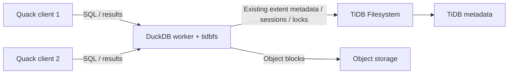

# Quack + tidbfs on DuckDB 2.0

Quack serves SQL from a DuckDB worker; tidbfs stores that worker's native
database and WAL on the existing shared extent filesystem. Clients load the
official Quack extension and receive a Quack token. Only workers need tidbfs
and filesystem credentials. The filesystem server does not execute SQL.



## Start a worker and connect clients

Build tidbfs with the exact DuckDB 2.0.0 SDK and CLI that will load it. Install
the matching official extension once with `INSTALL quack`. In the worker:

```sql
LOAD 'build/tidbfs.duckdb_extension';
LOAD quack;
CREATE SECRET fs (
    TYPE tidbfs,
    ENDPOINT 'https://YOUR_FILESYSTEM_ENDPOINT',
    TOKEN 'YOUR_FILESYSTEM_API_KEY'
);
ATTACH 'tidbfs+db:///warehouse.duckdb' AS shared;
USE shared;
CALL quack_serve('quack:localhost', token='YOUR_QUACK_TOKEN');
```

Each client can then run:

```sql
LOAD quack;
ATTACH 'quack:localhost' AS q (TOKEN 'YOUR_QUACK_TOKEN');
CONNECT q;
USE shared;
CREATE TABLE IF NOT EXISTS items(id BIGINT PRIMARY KEY, payload VARCHAR);
BEGIN;
INSERT INTO items VALUES (1, 'committed');
COMMIT;
SELECT * FROM items;
DISCONNECT;
```

`CONNECT` executes subsequent SQL on the worker, including `USE shared`.
Several client processes may write through one worker: DuckDB's normal MVCC
and transaction-conflict handling apply inside that worker. This does not
allow independent write-capable workers to open the same database concurrently.
For a read-only worker, attach its native database with `(READ_ONLY)`.

Use Quack's documented TLS/reverse-proxy and authorization configuration for
remote deployments. Filesystem permissions belong to the worker's credential;
they are not automatically mapped from individual Quack client identities.
The native extent API still requires an unscoped filesystem token.

## Failure and takeover behavior

For a clean handoff, drain client transactions, checkpoint if desired, and close
the old worker before opening the database in its replacement. Stopping only
the Quack listener is not a release of database ownership.

After SIGKILL, the existing extent session expires and the filesystem's ordinary
maintenance releases its locks. The replacement worker then opens the same URI
and recovers committed WAL. Uncommitted rows must not appear. There is no
filesystem-row editing, forced session cleanup, or new lease protocol in this
integration.

A storage partition can leave the old worker and its Quack listener alive. The
extent client permanently stops after transport ambiguity or its confirmed
session deadline. Restoring the network cannot revive that client: subsequent
writes fail and require a fresh worker. Servers advertising `session_guard`
also reject delayed mutations from expired/collected sessions transactionally;
older servers do not provide that server-side guarantee.

Applications reconnect and attach to the new Quack endpoint. Session-local
temporary tables, settings, and in-flight transactions are not migrated. An
ambiguous COMMIT or transport error is not proof of rollback: reopen and
reconcile application state, rather than replaying the write blindly.

The Quack connection heartbeat and `tidbfs_heartbeat_ms` are separate settings.
The latter controls filesystem ownership. The default remains 12 seconds,
with an approximately 60-second storage session. Shorter intervals require
`session_guard`; neither interval promises a fixed takeover time. See
[native storage recovery](native-database.md).

## Reproduce the integration tests

Install official Quack for the same DuckDB binary as `DUCKDB`, then run:

```sh
make test
python3 -m pip install pymysql==1.1.1 boto3==1.42.97
python3 scripts/test_native_live.py \
  --tidb-server /path/to/tidb-server \
  --fs-server /path/to/drive9-server \
  --rustfs-server "$PWD/build/rustfs" \
  --quack
```

The harness starts disposable TiDB, filesystem and RustFS services and fresh
database paths. `--quack-only` runs only C++ SDK conformance and Quack tests;
an optional `QuackTests.test_name` selects one case. Set
`TIDBFS_QUACK_EXTENSION` to an absolute Quack extension path if it is not in
DuckDB's default extension directory. Test CLIs disable agent formatting so
CSV/barrier results remain deterministic.

The seven Quack cases exercise separate client processes:

| Case | Required observation |
| --- | --- |
| Four concurrent writers and an observer | No dirty reads; complete transaction visibility; exact ordered-row checksum |
| Conflicting updates, rollback and snapshots | A write conflict reaches its caller; rollback and MVCC snapshots remain correct |
| Clean worker handoff and read-only serving | A second writer is excluded before release; new worker and multiple read-only clients see committed state |
| Worker SIGKILL with committed and pending transactions | Existing clients fail; replacement recovers only committed rows and accepts new writes |
| Metadata and object-storage partition of a live worker | Replacement acquires after expiry; restored old worker's COMMIT fails; no stale rows |
| Lost successful metadata-write acknowledgement | Error reaches the client; no publication replay; recovered outcome is reconciled |
| Transient RustFS upload failure and lost upload response | Existing immutable-object retries succeed without duplicate rows |

For current guarded servers, use `TIDBFS_REQUIRE_SESSION_GUARD=1` to require the
existing server-side delayed-publication regression too. Optionally set
`TIDBFS_QUACK_HEARTBEAT_MS=1000` to test shorter storage sessions on that server;
native smoke tests retain their own default heartbeat/failure windows.

Public CI runs all 30 analytical fixtures, the existing 14 native compatibility,
cross-route and transient-object cases, and four Quack cases: concurrency,
conflicts/snapshots, clean handoff/read-only serving, and transient object faults.
The three crash/partition/ambiguous-write takeover cases require current
`tidbcloud/fs`. The pinned public server's local fallback does not sweep expired
extent sessions; it also lacks transactional `session_guard`. Those complete
recovery cases stay enabled by default and are validated separately against
the current guarded server with real TiDB/TiKV and RustFS. Public CI is not
evidence of the newer server-side fencing guarantee.

The multipart stress stage repeats upload success, publication failure/abort,
and four concurrent CLI writers using many small Parquet row groups and
uncompressed outputs above DuckDB's 8 MiB remote async scheduling threshold. Both
default async scheduling and a single async thread retain the 45-second
command deadline and capture thread stacks on timeout.

## DuckDB 2.0 filesystem adaptation and limits

DuckDB 2.0's asynchronous COPY writers call `AbortFileWrite`. tidbfs discards
their private local staging instead of publishing incomplete output on close.
A write attempt, including a failed open or ambiguous publication, protects that query's destination from
generic COPY failure cleanup: a loser must not delete a concurrent publisher's
successful generation. This protection clears at the next query, so ordinary
overwrite/deletion behavior remains available.

Analytical HTTP range reads use a 64 KiB libcurl receive buffer. On the tested
Linux large-MSS loopback link, the default 16 KiB batches led to a 2 KiB
advertised receive window and roughly 200 ms probe cycles. Input reads then
exceeded the CLI deadline before multipart publication began. A same-runner
[16/64/16 KiB control](https://github.com/siddontang/duckdb-tidbfs/actions/runs/39842371234)
reproduced timeout/pass/timeout with the same binary. The concurrent multipart
regression checks complete row contents; the 45-second command deadline stays
in place, and normal CI runs without syscall tracing.

The native adapter retains its sync-per-write durability policy. The pure C++
client migration removes the Go bridge and its runtime; Quack continues to use
DuckDB's standard filesystem interface. Native databases remain experimental, with
advisory locks and incomplete production object-store/TiKV failover coverage.
Quack adds neither mandatory filesystem locking nor automatic worker scheduling.

References: [Quack overview](https://duckdb.org/docs/2.0/quack/overview),
[concurrency](https://duckdb.org/docs/2.0/connect/concurrency), and
[Quack security](https://duckdb.org/docs/2.0/quack/security).
