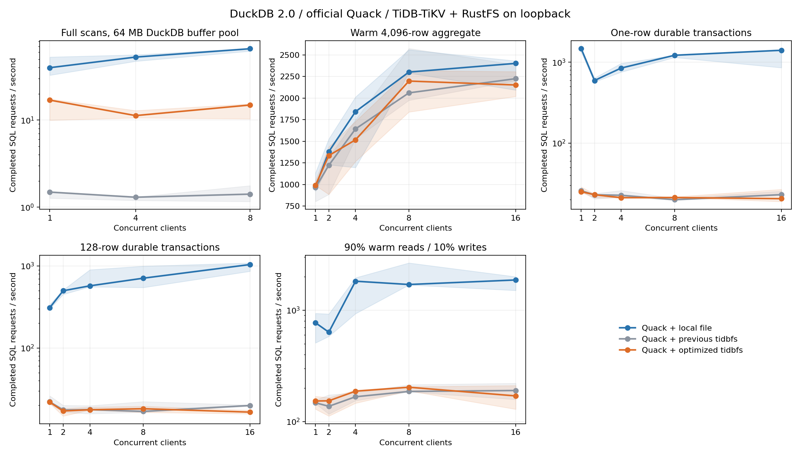
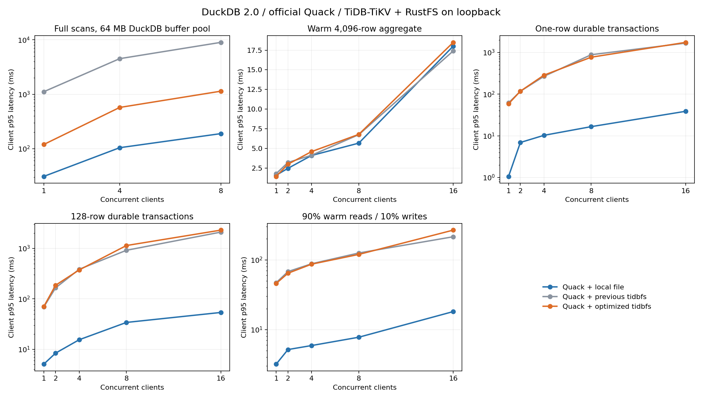

# Historical Go bridge baseline: Extent read path and Quack performance

This report records the earlier Go-backed implementation. The current C++ migration
and new measurements are described in [C++ client performance](cpp-client-performance.md).

Native databases and analytical files with extent layout share the same read
adapter. Positional reads now pass a caller-owned DuckDB buffer through a
synchronous binary C ABI to the existing VFS. The successful bridge path does
not allocate or serialize a payload, encode/decode Base64, or copy the returned
payload into another C++ buffer. The VFS still copies from its own cache; this
is not end-to-end zero-copy storage I/O. Control operations and writes keep the
existing JSON bridge and durability behavior.

Positional reads share the C++ handle guard and Go session lifetime guard.
Sequential reads, seek, close, write, sync, truncate, and session disconnect
retain exclusive guards. A close or disconnect waits for active reads. A
request that obtained the session before disconnect cannot use the stopped
runtime. Reads check session health before and after I/O; an expired session
cannot acknowledge data. Existing filesystem sessions and advisory locks are
unchanged. No new server endpoint, metadata table, or Quack dependency is added.

The old bridge performed O(B) JSON/Base64 serialization, parsing, decoding and
payload copies for B bytes. The new bridge passes O(1) buffer metadata per ABI call; the
underlying VFS read still takes O(B). Concurrent positional reads can overlap,
subject to the existing VFS reader, object store, and metadata behavior. The
session guard still excludes mutations across that session.

## Measured comparison — 2026-10-24

The eight-client buffer-limited scan improves from **1.41 to 14.88 SQL/s
(10.5×)**; client p95 falls from **8.96 s to 1.14 s**. The same-run local-file
reference reaches 65.77 SQL/s, so a substantial storage-path gap remains.
Worker CPU utilization rises from 1.10 to 3.20 cores, consistent with removing
the serial read bottleneck. A single client reaches 16.93 SQL/s versus the
previous plugin's 1.49 SQL/s. This measures the combined binary-transfer and
shared-guard change; it does not isolate each contribution.

Throughput is the median of three qualifying trials, in SQL statements/s.
For write workloads, each statement is one durable transaction. A 128-row
transaction therefore represents 128 times that many inserted rows.

| Workload (8 clients) | Local file | Previous tidbfs | Optimized tidbfs |
|---|---:|---:|---:|
| Buffer-limited full scan | 65.77 | 1.41 | 14.88 |
| Mostly cached range aggregate | 2301.18 | 2060.56 | 2197.10 |
| 1-row durable transaction | 1220.25 | 19.86 | 21.14 |
| 128-row durable transaction | 710.08 | 16.81 | 18.12 |
| 90% reads / 10% writes | 1698.70 | 186.45 | 203.45 |

Small differences in the mostly cached, write and mixed workloads should not
be treated as established gains or regressions from these short trials.
The 128-row write's pooled p95 is 0.92 s before and 1.14 s after; individual
trial p95 ranges overlap (0.75–1.29 s before, 0.94–1.20 s after). There is no
write-tail improvement demonstrated here. The existing S3-plus-metadata
persistence barrier is preserved.





[All configurations, latency quantiles and CPU measurements (CSV)](benchmarks/2026-10-24-extent-reads/summary.csv) ·
[Binary hashes, build metadata, method and excluded groups (JSON)](benchmarks/2026-10-24-extent-reads/results.json)

The run uses DuckDB 2.0.0 (`d54cbbe3df`), official Quack `f96420ed46`, the same
pinned public extent SDK and Go 1.26.0 for both macOS plugin artifacts, real
TiDB/TiKV 8.5.3 with one TiKV, and RustFS 1.0.3. All services use loopback on
an Apple M4 with 10 logical CPUs and 24 GiB memory. Production sources are
committed as `c635e86`; the baseline is the previously validated main artifact.
The JSON records the exact scored hashes and the embedded parent-revision
build metadata (the binaries were compiled before committing their changes).

There are 234 recorded runs, including resource-driven repeats. Select 207
runs in 69 complete three-backend groups; exclude five groups for paging and
retain all original samples. Every selected configuration has three trials.
Throughput shading shows the trial minimum/maximum; p95 pools successful
request latencies. Baseline full-scan sample counts are small, so their p99 is
exploratory. Host load varies between trials; loopback results are not a
production capacity estimate.

Matrix warm-up scans `a,b,c` and then issues three requests per client. Early
range queries may still fault in `id` blocks; this is a mostly cached workload,
rather than a guarantee that every requested block starts resident. The
buffer-limited scan reads three columns from a nominal 128 MiB table with a
64 MB DuckDB buffer pool; OS and object caches are not purged. The worker is
configured with `threads=4`; clients still contend for worker/cache resources.
Startup, attach and checkpoints run outside timing, including the additional
attribute refresh on locked opens. See the reproduction details below.

## Reproduce the benchmark

Use matching DuckDB 2.0 CLI, Python package and official Quack binaries. Install
`duckdb==2.0.0 psutil pymysql boto3` in an isolated Python environment. Build the
plugin with the matching headers. Supply the filesystem server and RustFS
binaries, and a TiDB binary or wrapper selecting an isolated TiKV/PD cluster.
The harness creates new databases and a disposable RustFS bucket with fresh
credentials, starts loopback-only services, and stops its services on exit.
Never pass an existing production service as a binary wrapper.

```sh
python scripts/benchmark_quack.py \
  --duckdb /path/to/duckdb \
  --quack-extension /path/to/quack.duckdb_extension \
  --extension build/tidbfs.duckdb_extension \
  --baseline-extension /path/to/baseline/tidbfs.duckdb_extension \
  --tidb-server /path/to/tidb-server-or-isolated-wrapper \
  --fs-server /path/to/drive9-server \
  --rustfs-server /path/to/rustfs \
  --out build/quack-matrix --rows 1048576 \
  --clients 1,2,4,8,16 --duration 8 --trials 3
```

Repeat with `--mode stream --rows 4194304 --workloads read_stream
--clients 1,4,8 --duration 10` to exceed the worker's 64 MB buffer pool. Omit
`--baseline-extension` for a two-backend comparison. Keep the basename
`tidbfs.duckdb_extension` so DuckDB resolves its entry point. On Linux, keep each plugin
beside its matching `libtidbfs_extent.so`.

Each Python client has its own in-memory DuckDB instance and Quack session;
the worker is a separate CLI process. All clients have one outstanding request
at a time. Backends run sequentially and the first backend rotates between
trials. The matrix uses a 1 GB worker buffer pool, four threads, warm range
aggregates, one-row commits, 128-row commits, and 90% reads / 10% writes to a
separate table in the same database. A 1 TB automatic checkpoint threshold
isolates WAL commit costs; manual checkpoints run outside the timed window.
Startup, attach and data creation are excluded. Every scan checksum and final
insert count/uniqueness are verified.

The harness saves per-request latency samples, throughput, p50/p95/p99,
checkpoint cost, process CPU/RSS, active host paging, and binary hashes. Exclude
an entire configuration/trial group if any backend exceeds 64 MiB swap-out or
128 MiB swap-in; preserve excluded raw samples and select repeat groups by
chronological order. Small sample counts cannot establish stable tail latency.
OS and object caches are not purged; buffer-limited scans are not physically
cold object-store benchmarks. Same-host results do not predict production
capacity or network latency.

## Regression coverage

`bridge/read_test.go` covers binary bytes, unaligned and maximum-size reads,
EOF, untouched destination guards, invalid ranges, concurrent same-handle
reads, close races, and session expiry before/during a read. Channel-gated unit
tests require actual reader overlap and verify mutation exclusion. The live
bridge suite runs with Go's race detector. Quack tests scan a database larger
than the buffer pool from four clients while another client commits, then
handoff, reopen, checkpoint and modify it. Existing native, cross-URI pinning,
truncated-download, crash/WAL recovery and worker takeover tests also exercise
the new read entry point.

## Lock handoff and test transport

A failed database open can cache the previous owner's file length before its
final checkpoint grows the database. Locked opens now invalidate the existing
SDK chunk/attribute cache and refresh the VFS reader length after acquiring the
lock. The lock handoff regression covers growth, shrinkage, and rewritten tail
bytes; the Quack regression reads and modifies checkpointed data after takeover.
This uses the existing metadata and locking interfaces.

The disposable S3 fault relay now has a 256-connection listening queue to
accommodate the existing client's 200-download limit. Its previous queue of
five could reset healthy download bursts before request logging, independent
of the plugin's read optimization. A gated accept-loop regression reproduces
the resets with the old queue and passes with the new one. Benchmarks connect
directly to RustFS and do not use this relay.
